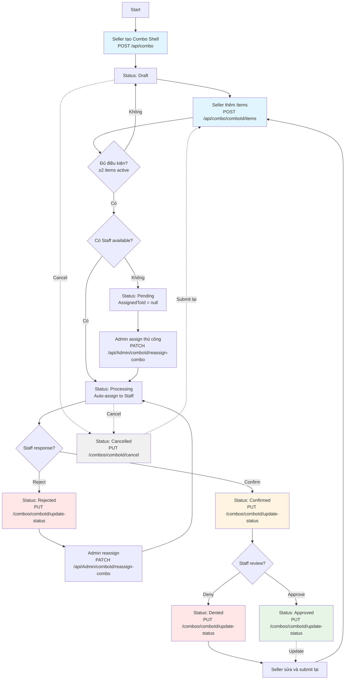

# Tài liệu Frontend: Luồng Tạo và Quản lý Combo

## 📋 Mục lục
1. [Tổng quan](#tổng-quan)
2. [Các Trạng thái Combo](#các-trạng-thái-combo)
3. [Actors và Quyền hạn](#actors-và-quyền-hạn)
4. [Flow Chart](#flow-chart)
5. [Chi tiết từng Luồng](#chi-tiết-từng-luồng)
6. [Danh sách API Endpoints](#danh-sách-api-endpoints)
7. [Edge Cases và Xử lý Lỗi](#edge-cases-và-xử-lý-lỗi)

---

## 1. Tổng quan

Hệ thống tạo combo là một quy trình phê duyệt nhiều bước với 3 actors chính: **Seller**, **Staff**, và **Admin**. Combo phải trải qua các trạng thái khác nhau và được xét duyệt bởi Staff trước khi được kích hoạt.

### Quy trình tổng quát:
```
Seller tạo Combo → Thêm Items → Submit → Staff nhận và xét duyệt → Approved/Denied
                                    ↓
                              (nếu không có Staff)
                                    ↓
                              Admin phải assign thủ công
```

---

## 2. Các Trạng thái Combo

| Trạng thái | Mã số | Mô tả | Seller có thể sửa? | Next States |
|------------|-------|-------|-------------------|-------------|
| **Draft** | 1 | Combo mới tạo, chưa submit | ✅ Có | Pending, Processing |
| **Pending** | 2 | Đã submit nhưng chưa có Staff available | ❌ Không | Processing |
| **Processing** | 3.1 | Đã assign cho Staff, chờ Staff confirm | ❌ Không | Confirmed, Rejected, Cancelled |
| **Cancelled** | 3.2 | Đã bị hủy bởi Seller/Admin | ✅ Có (để submit lại) | Pending, Processing |
| **Rejected** | 4.1 | Staff từ chối nhận task | ❌ Không | Processing (sau khi Admin reassign) |
| **Confirmed** | 4.2 | Staff đã chấp nhận task và đang review | ❌ Không | Approved, Denied |
| **Denied** | 5.1 | Staff từ chối nội dung combo | ✅ Có (để sửa và submit lại) | Pending, Processing |
| **Approved** | 5.2 | Combo đã được phê duyệt và kích hoạt | ✅ Có (nếu cần update) | Pending, Processing |

### ⚠️ Quan trọng:
- Seller **CHỈ có thể sửa** combo khi ở trạng thái: `Draft`, `Cancelled`, `Denied`, `Approved`
- Seller **KHÔNG thể sửa** khi ở trạng thái: `Pending`, `Processing`, `Rejected`, `Confirmed`

---

## 3. Actors và Quyền hạn

### 🛒 Seller
- Tạo combo mới
- Thêm/sửa combo items
- Submit combo để duyệt
- Hủy combo (chỉ ở trạng thái cho phép)
- Sửa thông tin combo (chỉ ở trạng thái cho phép)

### 👨‍💼 Staff
- Xem danh sách combo được assign
- Confirm hoặc Reject assignment
- Approve hoặc Deny combo (sau khi đã confirm)

### 👑 Admin
- Xem tất cả combo theo trạng thái
- Reassign combo cho Staff khác (khi combo ở trạng thái Rejected hoặc Pending)
- Xem độ rảnh của các Staff

---

## 4. Flow Chart



---

## 5. Chi tiết từng Luồng

### 🎯 LUỒNG 1: Seller Tạo Combo (Happy Path)

#### Bước 1: Tạo Combo Shell
**Trang:** Trang tạo combo mới

```javascript
// API Call
POST /api/combo

// Request Body (multipart/form-data)
{
  Name: string,
  SellerId: Guid,
  Description?: string,
  ThumbnailFile?: File
}

// Response
{
  Status: 201,
  Message: "Tạo phần cơ bản của combo thành công. Hãy thêm sản phẩm.",
  Data: {
    Id: Guid,
    Name: string,
    Status: "Draft",
    StoreId: Guid,
    ComboItems: [],
    // ... other fields
  }
}
```

**Sau khi tạo thành công:**
- Combo có status = `Draft`
- Redirect đến trang danh sách combo hoặc trang thêm items

---

#### Bước 2: Xem Danh sách Combo
**Trang:** Trang danh sách combo của Seller

```javascript
// API Call
GET /api/Combo?pageSize=10&pageNumber=1&sellerID={sellerId}

// Response
{
  Status: 200,
  Message: "Success",
  Data: [
    {
      Id: Guid,
      Name: string,
      Status: "Draft" | "Pending" | "Processing" | ...,
      ComboItems: [...],
      // ...
    }
  ],
  pagination: {
    PageNumber: 1,
    PageSize: 10,
    TotalItems: 5
  }
}
```

**UI Logic:**
- Hiển thị các combo với status badge (màu sắc khác nhau)
- Button "Thêm sản phẩm" chỉ hiện với status: `Draft`, `Cancelled`, `Denied`, `Approved`
- Button "Submit để duyệt" chỉ hiện với status: `Draft`, `Cancelled`, `Denied`, `Approved`

---

#### Bước 3: Xem Chi tiết Combo và Thêm Items
**Trang:** Trang chi tiết combo (sau khi click vào một combo)

```javascript
// API Call 1: Lấy chi tiết combo
GET /api/Combo/{comboId}

// Response
{
  Status: 200,
  Data: {
    Id: Guid,
    Name: string,
    Status: "Draft",
    ComboItems: [
      {
        Id: Guid,
        ProductVariantId: Guid,
        Quantity: number,
        ProductVariantName: string,
        // ...
      }
    ],
    // ...
  }
}

// API Call 2: Lấy danh sách sản phẩm để thêm vào combo
GET /api/ProductVariant/get-all-active/{storeId}

// Response
{
  Data: [
    {
      Id: Guid,
      Name: string,
      Price: number,
      StockQuantity: number,
      // ...
    }
  ]
}
```

---

#### Bước 4: Thêm Item vào Combo

```javascript
// API Call
POST /api/combo/{comboId}/items

// Request Body
{
  ProductVariantId: Guid,
  Quantity: number
}

// Response - Case 1: Thêm thành công nhưng chưa đủ điều kiện submit
{
  Status: 201,
  Message: "Success",
  Data: {
    Id: Guid,
    Status: "Draft", // Vẫn là Draft vì chưa đủ 2 items
    ComboItems: [
      { /* item vừa thêm */ }
    ]
  }
}

// Response - Case 2: Đủ điều kiện, có Staff available
{
  Status: 201,
  Message: "Success",
  Data: {
    Id: Guid,
    Status: "Processing", // ⚡ Tự động chuyển sang Processing
    AssignedToId: "staff-guid-here",
    ComboItems: [
      { /* item 1 */ },
      { /* item 2 */ }
    ]
  }
}

// Response - Case 3: Đủ điều kiện, KHÔNG có Staff available
{
  Status: 201,
  Message: "Success",
  Data: {
    Id: Guid,
    Status: "Pending", // ⚡ Chuyển sang Pending
    AssignedToId: null,
    ComboItems: [
      { /* item 1 */ },
      { /* item 2 */ }
    ]
  }
}
```

**⚠️ Điều kiện tự động submit:**
- Khi combo có `≥ 2 items` với status là `Active`
- Hệ thống sẽ tự động gọi `GetNextAvailableStaffForTaskAsync()`
- **CÓ Staff available:** Status → `Processing`, AssignedToId được set
- **KHÔNG có Staff:** Status → `Pending`, AssignedToId = null

**UI Logic sau khi thêm item:**
```javascript
if (response.Data.Status === "Processing") {
  // Hiển thị thông báo: "Combo đã được gửi đến Staff để xét duyệt"
  // Disable các button Edit/Add Item
} else if (response.Data.Status === "Pending") {
  // Hiển thị thông báo: "Combo đang chờ Admin phân công Staff"
  // Disable các button Edit/Add Item
} else if (response.Data.Status === "Draft") {
  // Vẫn cho phép thêm item
}
```

---

### 🎯 LUỒNG 2: Seller Sửa/Cập nhật Combo

#### Case 2.1: Sửa Thông tin Combo Shell

```javascript
// API Call
PUT /api/combo/{comboId}

// Request Body (multipart/form-data)
{
  Name: string,
  Description?: string,
  IsActive: boolean,
  ThumbnailFile?: File
}

// ⚠️ CHỈ gọi được khi Status ∈ {Draft, Cancelled, Denied, Approved}

// Response - Success
{
  Status: 200,
  Message: "Cập nhật thông tin cơ bản của combo thành công.",
  Data: { /* updated combo */ }
}

// Response - Error (nếu combo đang ở trạng thái không cho phép)
{
  Status: 400,
  Message: "Không thể chỉnh sửa combo đang trong quá trình xét duyệt."
}
```

---

#### Case 2.2: Sửa Combo Item

```javascript
// API Call
PUT /api/combo/{comboId}/items/{itemId}

// Request Body
{
  Quantity: number
}

// ⚠️ CHỈ gọi được khi Status ∈ {Draft, Cancelled, Denied, Approved}

// Response
{
  Status: 200,
  Message: "Success",
  Data: { /* updated combo */ }
}
```

---

### 🎯 LUỒNG 3: Seller Hủy Combo

```javascript
// API Call
PUT /api/combos/{comboId}/cancel

// ⚠️ CHỈ gọi được khi Status KHÔNG PHẢI {Confirmed, Rejected}
// Có thể hủy ở: Draft, Pending, Processing, Denied, Approved

// Response - Success
{
  Status: 200,
  Message: "Hủy yêu cầu tạo combo thành công.",
  Data: {
    Id: Guid,
    Status: "Cancelled",
    // ...
  }
}

// Response - Error
{
  Status: 400,
  Message: "Không thể hủy combo đang ở trạng thái này."
}
```

**UI Logic:**
- Button "Hủy" chỉ hiển thị khi Status ∉ {Confirmed, Rejected}
- Sau khi hủy thành công, combo có thể được submit lại

---

### 🎯 LUỒNG 4: Seller Submit Combo Thủ công

```javascript
// API Call
PUT /api/combos/{comboId}/submit

// ⚠️ Chỉ cần gọi khi muốn submit thủ công từ Draft/Cancelled/Denied/Approved
// Điều kiện: Combo phải có ≥2 items active

// Request: Không cần body

// Response - Case 1: Có Staff available
{
  Status: 200,
  Message: "Gửi yêu cầu duyệt combo thành công.",
  Data: {
    Id: Guid,
    Status: "Processing",
    AssignedToId: "staff-guid",
    // ...
  }
}

// Response - Case 2: Không có Staff available
{
  Status: 200,
  Message: "Gửi yêu cầu duyệt combo thành công.",
  Data: {
    Id: Guid,
    Status: "Pending",
    AssignedToId: null,
    // ...
  }
}

// Response - Error: Không đủ điều kiện
{
  Status: 400,
  Message: "Combo phải có ít nhất 2 sản phẩm đang hoạt động."
}
```

---

### 🎯 LUỒNG 5: Staff Xem và Xử lý Combo

#### Bước 5.1: Staff Xem Danh sách Combo được phân công

**Trang:** Dashboard của Staff

```javascript
// API Call
GET /api/Staff/{staffId}/combos-for-review?storeId={storeId}&status={status}&pageSize=10&pageNumber=1

// Query Parameters:
// - storeId (optional): Lọc theo cửa hàng
// - status (optional): Lọc theo trạng thái
// - pageSize, pageNumber: Phân trang

// Response
{
  Status: 200,
  Message: "Lấy danh sách combo được giao cho nhân viên thành công.",
  Data: [
    {
      Id: Guid,
      Name: string,
      Status: "Processing" | "Confirmed",
      AssignedToId: staffId,
      // ...
    }
  ],
  pagination: { /* ... */ }
}
```

**UI Logic:**
- Hiển thị combo với status `Processing` → Cần confirm/reject
- Hiển thị combo với status `Confirmed` → Cần approve/deny

---

#### Bước 5.2: Staff Confirm hoặc Reject Assignment

**Case 5.2.1: Staff CHẤP NHẬN nhiệm vụ**

```javascript
// API Call
PUT /api/Staff/combos/{comboId}/update-status

// Request: Không cần body

// Response
{
  Status: 200,
  Message: "Xác nhận nhiệm vụ xử lý combo thành công.",
  Data: {
    Id: Guid,
    Status: "Confirmed", // ⚡ Processing → Confirmed
    // ...
  }
}
```

**Case 5.2.2: Staff TỪ CHỐI nhiệm vụ**

```javascript
// API Call
PUT /api/Staff/combos/{comboId}/reject-assignment

// Request Body
{
  Note: string // Required: Lý do từ chối
}

// Response
{
  Status: 200,
  Message: "Đã từ chối yêu cầu thành công. Combo đã được trả về hàng đợi.",
  Data: {
    Id: Guid,
    Status: "Rejected", // ⚡ Processing → Rejected
    StaffNote: "Lý do từ chối...",
    // ...
  }
}
```

**⚠️ Lưu ý:**
- Khi Staff reject, combo chuyển sang `Rejected`
- Admin phải reassign cho Staff khác
- Combo sẽ quay về `Processing` sau khi Admin reassign

---

#### Bước 5.3: Staff Approve hoặc Deny Combo (sau khi đã Confirm)

**Case 5.3.1: Staff PHÊ DUYỆT combo**

```javascript
// API Call
PUT /api/Staff/combos/{comboId}/update-status

// Request Body
{
  Status: "Approved",
  StaffFeedback?: string
}

// ⚠️ CHỈ gọi được khi combo ở status: Confirmed

// Response
{
  Status: 200,
  Message: "Đã cập nhật trạng thái combo thành công sang 'Approved'.",
  Data: {
    Id: Guid,
    Status: "Approved", // ⚡ Confirmed → Approved
    StaffNote: "Feedback từ Staff...",
    // ...
  }
}
```

**Case 5.3.2: Staff TỪ CHỐI combo**

```javascript
// API Call
PUT /api/Staff/combos/{comboId}/update-status

// Request Body
{
  Status: "Denied",
  StaffFeedback: string // Required khi deny
}

// ⚠️ CHỈ gọi được khi combo ở status: Confirmed

// Response
{
  Status: 200,
  Message: "Đã cập nhật trạng thái combo thành công sang 'Denied'.",
  Data: {
    Id: Guid,
    Status: "Denied", // ⚡ Confirmed → Denied
    StaffNote: "Lý do từ chối combo...",
    // ...
  }
}
```

**⚠️ Lưu ý:**
- Khi bị `Denied`, Seller có thể sửa combo và submit lại
- Khi `Approved`, combo được kích hoạt và có thể được cập nhật

---

### 🎯 LUỒNG 6: Admin Quản lý Combo

#### Bước 6.1: Admin Xem Danh sách Combo

```javascript
// API Call
GET /api/Admin/combos?Status={status}&StaffId={staffId}&StoreId={storeId}&PageSize=10&PageNumber=1

// Query Parameters:
// - Status (optional): Filter theo trạng thái
// - StaffId (optional): Filter theo Staff được assign
// - StoreId (optional): Filter theo cửa hàng
// - PageSize, PageNumber: Phân trang

// Response
{
  Status: 200,
  Message: "Lấy danh sách combo thành công.",
  Data: [
    {
      Id: Guid,
      Status: string,
      AssignedToId?: Guid,
      // ...
    }
  ],
  pagination: { /* ... */ }
}
```

---

#### Bước 6.2: Admin Xem Độ rảnh của Staff

```javascript
// API Call
GET /api/Admin/staff/combo-availability

// Response
{
  Status: 200,
  Message: "Lấy danh sách độ rảnh của nhân viên theo combo thành công.",
  Data: [
    {
      StaffId: Guid,
      StaffName: string,
      Email: string,
      ProcessingComboCount: number // Số combo đang xử lý
    }
  ]
}
```

**UI Logic:**
- Sắp xếp Staff theo `ProcessingComboCount` tăng dần
- Staff có count thấp nhất = rảnh nhất

---

#### Bước 6.3: Admin Reassign Combo

```javascript
// API Call
PATCH /api/Admin/{comboId}/reassign-combo

// Request Body
{
  NewStaffId: Guid // Required
}

// ⚠️ Thường gọi khi combo ở status: Rejected hoặc Pending

// Response
{
  Status: 200,
  Message: "Gán nhân viên cho form thành công.",
  Data: {
    ComboId: Guid,
    ComboName: string,
    PreviousStatus: "Rejected" | "Pending",
    NewStatus: "Processing", // ⚡ Luôn chuyển về Processing
    AssignedToStaffId: Guid,
    Message: "Đã gán lại combo thành công"
  }
}
```

**Flow sau khi reassign:**
1. Admin reassign → Status = `Processing`
2. Staff mới nhận được combo
3. Staff phải confirm/reject lại
4. Nếu confirm → `Confirmed` → có thể approve/deny
5. Nếu reject → `Rejected` → Admin phải reassign lại

---

## 6. Danh sách API Endpoints

### 📦 Combo APIs (Seller)

| Method | Endpoint | Mô tả | Actor | Status cho phép |
|--------|----------|-------|-------|----------------|
| POST | `/api/combo` | Tạo combo shell mới | Seller | N/A |
| GET | `/api/Combo` | Lấy danh sách combo | Seller | All |
| GET | `/api/Combo/{id}` | Lấy chi tiết combo | Seller | All |
| PUT | `/api/combo/{id}` | Cập nhật combo shell | Seller | Draft, Cancelled, Denied, Approved |
| POST | `/api/combo/{comboId}/items` | Thêm item vào combo | Seller | Draft, Cancelled, Denied, Approved |
| PUT | `/api/combo/{comboId}/items/{itemId}` | Cập nhật item trong combo | Seller | Draft, Cancelled, Denied, Approved |
| PUT | `/api/combos/{comboId}/submit` | Submit combo để duyệt | Seller | Draft, Cancelled, Denied, Approved |
| PUT | `/api/combos/{comboId}/cancel` | Hủy combo | Seller | NOT (Confirmed, Rejected) |

### 👨‍💼 Staff APIs

| Method | Endpoint | Mô tả | Status combo |
|--------|----------|-------|-------------|
| GET | `/api/Staff/{staffId}/combos-for-review` | Lấy danh sách combo được assign | Processing, Confirmed |
| PUT | `/api/Staff/combos/{comboId}/update-status` | Approve/Deny/Reject/Confirm combo | Confirmed → Approved/Denied/Rejected/Confirmed |

### 👑 Admin APIs

| Method | Endpoint | Mô tả |
|--------|----------|-------|
| GET | `/api/Admin/combos` | Lấy danh sách combo (filter theo status/staff/store) |
| GET | `/api/Admin/staff/combo-availability` | Lấy độ rảnh của Staff |
| PATCH | `/api/Admin/{comboId}/reassign-combo` | Reassign combo cho Staff khác |

### 🛍️ Product API

| Method | Endpoint | Mô tả |
|--------|----------|-------|
| GET | `/api/ProductVariant/get-all-active/{storeId}` | Lấy danh sách sản phẩm active của store |

---

## 7. Edge Cases và Xử lý Lỗi

### ❌ Case 1: Seller cố gắng sửa combo đang trong quá trình xét duyệt

```javascript
// Khi combo có status ∈ {Pending, Processing, Rejected, Confirmed}
// và Seller gọi PUT /api/combo/{id}

// Response
{
  Status: 400,
  Message: "Không thể chỉnh sửa combo đang trong quá trình xét duyệt."
}

// UI Logic:
// - Disable tất cả button Edit/Add Item
// - Hiển thị message: "Combo đang được xét duyệt, không thể chỉnh sửa"
// - Hiển thị status badge rõ ràng
```

---

### ❌ Case 2: Seller submit combo chưa đủ 2 items

```javascript
// Khi gọi PUT /api/combos/{comboId}/submit
// nhưng combo có < 2 items active

// Response
{
  Status: 400,
  Message: "Combo phải có ít nhất 2 sản phẩm đang hoạt động."
}

// UI Logic:
// - Validate trước khi cho phép submit
// - Hiển thị warning: "Combo cần ít nhất 2 sản phẩm để gửi duyệt"
// - Disable button Submit khi chưa đủ điều kiện
```

---

### ❌ Case 3: Staff không phải người được assign cố gắng xử lý combo

```javascript
// Response
{
  Status: 403,
  Message: "Bạn không có quyền xử lý combo này."
}

// UI Logic:
// - Chỉ hiển thị combo mà Staff đó được assign
// - Filter theo AssignedToId === currentStaffId
```

---

### ❌ Case 4: Combo ở trạng thái Pending quá lâu

**Kịch bản:** Không có Staff available khi Seller thêm item thứ 2

```javascript
// Combo status = "Pending", AssignedToId = null

// Giải pháp:
// 1. Admin cần vào GET /api/Admin/combos?Status=Pending
// 2. Admin chọn Staff từ GET /api/Admin/staff/combo-availability
// 3. Admin gọi PATCH /api/Admin/{comboId}/reassign-combo

// UI cho Seller:
// - Hiển thị message: "Combo đang chờ Admin phân công nhân viên xét duyệt"
// - Hiển thị status badge: "Pending" (màu vàng/cam)
```

---

### ❌ Case 5: Staff reject assignment liên tục

**Kịch bản:** Staff A reject → Admin assign cho Staff B → Staff B cũng reject

```javascript
// Mỗi lần Staff reject:
// Status: Processing → Rejected

// Admin phải:
// 1. Xem lý do reject trong StaffNote
// 2. Chọn Staff phù hợp hơn
// 3. Reassign lại

// UI cho Admin:
// - Hiển thị history các lần reject (nếu có)
// - Hiển thị StaffNote của lần reject gần nhất
// - Suggest Staff có workload thấp
```

---

### ❌ Case 6: Seller hủy combo khi Staff đã confirm

```javascript
// Khi combo status = "Confirmed"
// Seller gọi PUT /api/combos/{comboId}/cancel

// Response
{
  Status: 400,
  Message: "Không thể hủy combo đang ở trạng thái Confirmed. Vui lòng liên hệ Admin."
}

// UI Logic:
// - Hide button "Hủy" khi status = Confirmed
// - Hiển thị message: "Combo đang được Staff xét duyệt, không thể hủy"
```

---

### ✅ Case 7: Combo bị Denied, Seller sửa và submit lại

**Flow:**
1. Combo có status = `Denied`
2. Seller sửa combo: PUT `/api/combo/{id}` (allowed)
3. Seller sửa items: PUT `/api/combo/{comboId}/items/{itemId}` (allowed)
4. Seller submit lại: PUT `/api/combos/{comboId}/submit`
5. System check Staff availability:
   - Có Staff → `Processing`
   - Không có Staff → `Pending`

```javascript
// UI Logic sau khi bị Denied:
// - Hiển thị StaffNote: "Lý do từ chối: ..."
// - Enable button Edit/Add Item
// - Enable button "Submit lại"
// - Highlight các vấn đề cần sửa (nếu có trong StaffNote)
```

---

### ✅ Case 8: Combo đã Approved, Seller muốn update

**Flow:**
1. Combo có status = `Approved`, đang active
2. Seller update combo: PUT `/api/combo/{id}` (allowed)
3. Seller submit lại: PUT `/api/combos/{comboId}/submit`
4. Combo đi lại quy trình review từ đầu

```javascript
// UI Logic:
// - Hiển thị warning: "Combo đang hoạt động, nếu submit lại sẽ phải chờ duyệt"
// - Confirm dialog trước khi submit
// - Hiển thị timestamp của lần approve trước
```

---

## 📊 State Transition Summary

```
Draft
  ├─→ [Add ≥2 items + có Staff] → Processing
  ├─→ [Add ≥2 items + không Staff] → Pending
  ├─→ [Submit thủ công + có Staff] → Processing
  ├─→ [Submit thủ công + không Staff] → Pending
  └─→ [Cancel] → Cancelled

Pending
  └─→ [Admin assign] → Processing

Processing
  ├─→ [Staff confirm] → Confirmed
  ├─→ [Staff reject] → Rejected
  └─→ [Cancel] → Cancelled

Rejected
  └─→ [Admin reassign] → Processing

Confirmed
  ├─→ [Staff approve] → Approved
  └─→ [Staff deny] → Denied

Cancelled
  └─→ [Submit lại] → Processing/Pending

Denied
  └─→ [Seller sửa + submit lại] → Processing/Pending

Approved
  └─→ [Seller update + submit lại] → Processing/Pending
```

---

## 🎨 UI/UX Recommendations

### Status Badge Colors
```css
.status-draft { background: #gray; }
.status-pending { background: #orange; }
.status-processing { background: #blue; }
.status-confirmed { background: #purple; }
.status-rejected { background: #red; }
.status-cancelled { background: #dark-gray; }
.status-denied { background: #red; }
.status-approved { background: #green; }
```

### Button Visibility Matrix

| Status | Edit Button | Add Item | Submit | Cancel | Approve/Deny |
|--------|------------|----------|--------|--------|--------------|
| Draft | ✅ | ✅ | ✅ | ✅ | ❌ |
| Pending | ❌ | ❌ | ❌ | ❌ | ❌ |
| Processing | ❌ | ❌ | ❌ | ✅ | ❌ |
| Confirmed | ❌ | ❌ | ❌ | ❌ | ✅ (Staff only) |
| Rejected | ❌ | ❌ | ❌ | ❌ | ❌ |
| Cancelled | ✅ | ✅ | ✅ | ❌ | ❌ |
| Denied | ✅ | ✅ | ✅ | ❌ | ❌ |
| Approved | ✅ | ✅ | ✅ | ❌ | ❌ |

### Progress Indicator
```
Seller View:
[Draft] → [Đang chờ duyệt] → [Đã duyệt] / [Bị từ chối]

Staff View:
[Mới nhận] → [Đã confirm] → [Đã xét duyệt]

Admin View:
[Tất cả combo] với filter theo status + staff + store
```

---

## 📝 Checklist cho Frontend Developer

### Seller Pages
- [ ] Form tạo combo mới (POST /api/combo)
- [ ] List combo với filter và pagination
- [ ] Chi tiết combo với list items
- [ ] Form thêm/sửa items
- [ ] Button Submit với validation (≥2 items)
- [ ] Button Cancel với confirmation
- [ ] Disable edit khi không được phép
- [ ] Hiển thị StaffNote khi bị Denied
- [ ] Status badge với màu sắc phù hợp

### Staff Pages
- [ ] Dashboard xem combo được assign
- [ ] Button Confirm/Reject assignment
- [ ] Form nhập lý do khi reject
- [ ] Button Approve/Deny combo
- [ ] Form nhập feedback khi approve/deny
- [ ] Filter theo status (Processing, Confirmed)
- [ ] Phân trang

### Admin Pages
- [ ] Dashboard xem tất cả combo
- [ ] Filter theo Status/Staff/Store
- [ ] Xem độ rảnh của Staff
- [ ] Form reassign combo cho Staff khác
- [ ] Highlight combo ở trạng thái Pending/Rejected
- [ ] Phân trang

### Error Handling
- [ ] Toast/notification cho success/error
- [ ] Form validation trước khi submit
- [ ] Loading state cho async operations
- [ ] Retry mechanism cho failed requests
- [ ] Clear error messages

---

## 🔗 Related Documents
- State Machine Document (Vietnamese)
- API Controllers Source Code
- DTO Definitions

**Phiên bản:** 1.0
**Ngày cập nhật:** 2025-10-23